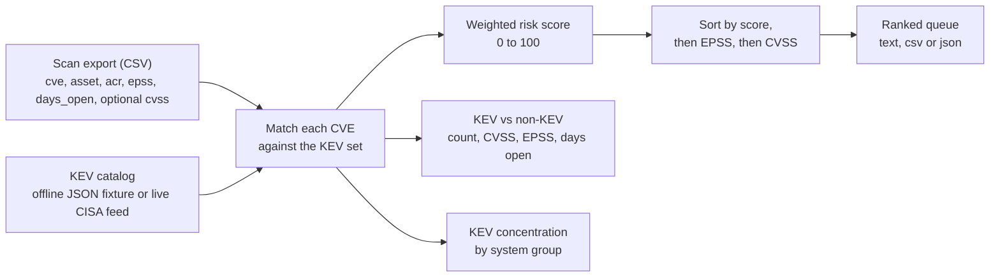

# kev-risk-prioritization

[](https://github.com/samiali38183/kev-risk-prioritization/actions/workflows/ci.yml)


**A small, readable weighted score that ranks vulnerability findings with known-exploited (CISA KEV) CVEs first, then asset criticality, EPSS and CVSS. A case study and reference implementation, not an implementation of CISA BOD 26-04.**

Scanners return more findings than a team can patch. Sorting by CVSS puts severity first and ignores whether anyone is exploiting the bug. This tool puts KEV matches first. The score, its weights and the way it is tested are this project's own design; [what BOD 26-04 actually requires, and how this differs](docs/bod-26-04.md), is written down separately.

> **Data note.** Two kinds of data are used, and they are kept apart. The **real snapshot** (CISA KEV catalog 2026.11.10 and FIRST EPSS scores for 2026-11-11, pinned in [`data/snapshot/`](data/snapshot/SNAPSHOT.md)) gives real KEV membership and real EPSS values. Everything about assets (ACR, names, days open) is **invented**, and CVSS is **not used** with the real data. The small **synthetic demo** (`data/sample_*`) uses real KEV CVE IDs with invented values throughout. No internal, DHS or CBP data is in this repository.

## The problem

CVSS describes how bad a vulnerability could be, not whether it is being used. A 9.8 nobody has weaponized is less urgent than a 7.5 under mass exploitation. For US federal civilian agencies, CISA BOD 26-04 (June 2026) sets remediation deadlines from four variables: whether the asset is publicly exposed, whether the CVE is in KEV, whether exploitation is automatable, and technical impact (partial or total control). It is a lookup table, not a score, and KEV is only one of the four inputs. This project does not implement it; see [`docs/bod-26-04.md`](docs/bod-26-04.md). EPSS, CVSS and asset criticality are this project's inputs and none of them is a BOD 26-04 input.

The question this tool answers: if you can fix only a slice of open findings this sprint, which ones?

## Methodology and architecture

Pipeline (one pass, in memory, standard library only):



The score, defined in [`docs/methodology.md`](docs/methodology.md) section 6:

```
risk = 100 * ( 0.40*kev + 0.25*(acr/8) + 0.20*epss + 0.20*(cvss/10) ) / 1.05
```

| Input | Weight | Why |
|---|---|---|
| KEV match (0/1) | 0.40 | Confirmed exploitation is treated as the strongest signal (a design choice, not a validated weight) |
| Asset criticality, ACR 1-8 | 0.25 | Same CVE matters more on a critical or internet-exposed system |
| EPSS (0-1) | 0.20 | Probability of exploitation in the next 30 days |
| CVSS (0-10) | 0.20 | Severity if exploited |

The KEV weight (0.40) equals the EPSS and CVSS weights combined, so on the same asset a KEV finding never scores below a non-KEV finding; the two tie only at the extreme of EPSS 1.0 and CVSS 10 against 0 and 0. If a finding has no CVSS value, that term and its weight are dropped and the rest is renormalized to 0-100.

## Engineering decisions

- **Standard library only** (`csv`, `json`, `argparse`, `statistics`, `urllib`). It runs on a locked-down analyst workstation with no package install.
- **Score normalized by the weight total.** The defaults sum to 1.05, so the raw composite would top out at 105. Dividing by `sum(weights)` keeps the scale at 0-100 for any re-tuned weight set; ordering is unchanged. A test asserts 100.0 at the maximum for a custom weight set.
- **Weights are data.** `DEFAULT_WEIGHTS` is a dict; pass another to `score_all()` to raise ACR for regulated environments or exposure for public-facing fleets.
- **Defensive inputs.** Values are clamped to documented ranges, CVE IDs match case-insensitively, and ties break deterministically on EPSS, then CVSS.
- **Offline-first.** KEV can come from a local JSON file in the CISA feed schema, so the demo and CI need no network. `--kev-live` fetches the real catalog over one HTTPS request.
- **Pinned evidence.** The real-data snapshot carries SHA-256 hashes of its raw downloads, a seeded (SHA-256 based, interpreter independent) sample, and a golden file so changes in the tool's output on real data show up in CI.
- **Three output formats** (text, CSV, JSON) so the ranked queue can feed a dashboard or ticketing import.

## Evidence

### Real data (pinned snapshot, no invented numbers)

Full method, caveats and tables: [`docs/real_data_analysis.md`](docs/real_data_analysis.md), generated by `scripts/analyze_snapshot.py` from the snapshot (KEV 2026.11.10, 1,779 entries; EPSS model v2026.06.15 scored 2026-11-11, 404,864 CVEs). What it shows:

- EPSS separates KEV from a seeded sample of 5,000 non-KEV CVEs with AUC 0.9515 (95% bootstrap interval 0.9454 to 0.9565). Median EPSS is 0.533 for KEV and 0.006 for the non-KEV sample.
- Of the 1,779 KEV CVEs, 1,338 (75.2%) have EPSS >= 0.1, 909 (51.1%) >= 0.5 and 489 (27.5%) >= 0.9. Over the whole EPSS file, 16,203 non-KEV CVEs are also >= 0.1, so at population prevalence (KEV is 0.44% of scored CVEs) the precision of "EPSS >= 0.1" for KEV membership is 7.6% (20.7% at 0.5, 59.2% at 0.9).
- On a 2,000-row mixed list (100 KEV + 1,900 non-KEV, invented ACR) the tool puts all 100 KEV findings in its top 100; EPSS alone puts 65 there. That is mostly by construction, since KEV carries 0.40 of the weight.

What it does **not** show: that the ranking improves remediation outcomes. EPSS is trained on exploitation evidence that overlaps with what KEV records (so the KEV-vs-EPSS result is partly circular), KEV is an incomplete label, there is no time dimension, and CVSS was not available.

### Synthetic demo (illustrates the formula only)

`data/sample_findings.csv` holds 20 findings with real KEV CVE IDs and **invented** assets, ACR, EPSS, CVSS and ages, chosen to show the ordering. Reproduced on 2026-11-11 (Python 3.12.2): 12 KEV and 8 non-KEV findings; a CVSS-only sort puts 9 KEV findings in its top 12, the risk score puts all 12 there; the lowest-scoring KEV finding scores 85.0 and the highest-scoring non-KEV finding 38.5. The group averages (CVSS 9.53 vs 8.34, EPSS 0.935 vs 0.029) are properties of the invented inputs and say nothing about real vulnerability populations.

## Quick start

Python 3.9+, no dependencies.

```bash
git clone https://github.com/samiali38183/kev-risk-prioritization
cd kev-risk-prioritization

# rank the synthetic demo against the offline KEV fixture
python kev_prioritize.py data/sample_findings.csv --kev data/sample_kev.json

# same, against the live CISA KEV catalog
python kev_prioritize.py data/sample_findings.csv --kev-live

# rank the mixed list built from the real snapshot (real KEV and EPSS, invented assets, no CVSS)
python kev_prioritize.py data/snapshot/mixed_findings.csv --kev data/snapshot/known_exploited_vulnerabilities.json --top 25

# machine-readable output
python kev_prioritize.py data/sample_findings.csv --kev data/sample_kev.json --format csv -o ranked.csv
python kev_prioritize.py data/sample_findings.csv --kev data/sample_kev.json --format json

# regenerate the real-data analysis / rebuild the snapshot
python scripts/analyze_snapshot.py
python scripts/fetch_snapshot.py --date 2026-11-11

# tests
python -m unittest discover -s tests
```

Input CSV columns: `cve, asset, acr (1-8), epss (0-1), days_open`; optional `cvss (0-10), system_group, vendor, internet_exposed`.

## Example output (synthetic demo)

```
$ python kev_prioritize.py data/sample_findings.csv --kev data/sample_kev.json --top 14

  #  risk  KEV CVE              CVSS  EPSS ACR days  asset
  1  99.4  yes CVE-2021-44228   10.0 0.970   8   42  web-portal-01
  2  99.0  yes CVE-2024-3400    10.0 0.950   8    9  fw-edge-01
  3  98.1  yes CVE-2023-4966     9.4 0.960   8   18  vpn-gw-02
  ...
 11  86.9  yes CVE-2017-0144     8.1 0.970   5  210  file-srv-legacy
 12  85.0  yes CVE-2021-34527    8.8 0.960   4  160  print-srv-03
 13  38.5  -   CVE-2023-99996    8.8 0.050   7   22  backup-srv-02
 14  33.7  -   CVE-2023-99994    7.5 0.080   6   33  reporting-db-01

KEV vs non-KEV population
  kev      n=12  avg CVSS 9.53  avg EPSS 0.935  avg days open 94.2
  non_kev  n=8   avg CVSS 8.34  avg EPSS 0.029  avg days open 101.5

KEV concentration by system group: Remote Access=4, File Services=2, Public Web=1, ...
```

Row 13 is a CVSS 8.8 on a high-criticality asset (ACR 7). It ranks below every KEV match, including a CVSS 8.1 on an old file server (row 11). All values here are invented.

## Real-world applicability

The input is what a vulnerability scanner export plus an asset inventory already contains: CVE, asset, CVSS, a criticality rating, and an EPSS value from the public FIRST feed. A Tenable or Nessus export joined with an asset list maps onto the CSV columns directly. The output is a ranked work-list for a remediation sprint, with a population comparison and a KEV concentration view to show where remediation effort pays off most (for example, which system groups or vendors hold the exploited CVEs). The methodology is in [`docs/methodology.md`](docs/methodology.md), and [`docs/bod-26-04.md`](docs/bod-26-04.md) records what the directive actually says and what this tool leaves out.

## Limitations

- **Not an implementation of BOD 26-04.** The directive is a decision table over four variables (asset exposure, KEV status, exploit automation, technical impact) that yields per-asset deadlines of 3, 14 or 60 days or "fix on system upgrade", with a forensic-triage requirement at the top. This tool is a weighted sum. It does not model exposure as a decision variable (the optional `internet_exposed` column is not scored), Automatable, Technical Impact, the deadlines, or the KEV `forensicTriage` field. Details and sources: [`docs/bod-26-04.md`](docs/bod-26-04.md).
- **The weights are a design choice, not validated.** There is no outcome data behind 0.40/0.25/0.20/0.20. The real-data analysis describes how EPSS and KEV relate; it does not test the score.
- **Circular signals.** EPSS is trained on exploitation evidence that overlaps with KEV-style data, so combining them double counts to some degree and KEV-vs-EPSS separation is not independent validation.
- **KEV is incomplete.** A CVE missing from the catalog is not known to be safe.
- **No CVSS with real data.** The snapshot has no CVSS and none was fetched. CVSS-based claims rest only on the invented demo values.
- **Synthetic assets.** ACR, asset names and ages in every runnable example are invented.
- **Not a scanner or enrichment service.** It consumes the CVSS and EPSS values you supply. Live mode fetches only the KEV catalog.
- **Simple weighted sum.** Easy to explain and tune, but it cannot express a rule such as "KEV and internet-exposed always goes first".
- **No per-finding due dates.** Remediation age is reported as mean days open per population.

## Repository layout

```
kev_prioritize.py                 scoring, matching, population compare, CLI (stdlib only)
scripts/fetch_snapshot.py         builds/verifies the pinned snapshot (stdlib only)
scripts/analyze_snapshot.py       real-data analysis; writes docs/real_data_analysis.md
data/sample_findings.csv          20 synthetic findings (12 KEV, 8 non-KEV): the demo
data/sample_kev.json              offline KEV fixture for the demo
data/snapshot/                    pinned CISA KEV + FIRST EPSS subset, SNAPSHOT.md, mixed_findings.csv
tests/                            unit tests, snapshot integrity checks, golden output
docs/methodology.md               methodology
docs/bod-26-04.md                 what BOD 26-04 says, sourced, and how this project differs
docs/real_data_analysis.md        generated analysis of the snapshot
.github/workflows/ci.yml          tests, golden-file and analysis checks on Python 3.9 and 3.13; zizmor
CHANGELOG.md                      changes, including corrections to earlier claims
```

## References

- [CISA BOD 26-04: Prioritizing Security Updates Based on Risk](https://www.cisa.gov/news-events/directives/bod-26-04-prioritizing-security-updates-based-risk) · [implementation guidance](https://www.cisa.gov/news-events/directives/bod-26-04-implementation-guidance-prioritizing-security-updates-based-risk)
- [CISA Known Exploited Vulnerabilities Catalog](https://www.cisa.gov/known-exploited-vulnerabilities-catalog) · [JSON feed](https://www.cisa.gov/sites/default/files/feeds/known_exploited_vulnerabilities.json) · [license (CC0 1.0)](https://www.cisa.gov/sites/default/files/licenses/kev/license.txt)
- [FIRST Exploit Prediction Scoring System (EPSS)](https://www.first.org/epss/) · [FAQ and terms](https://www.first.org/epss/faq) · [how it works](https://www.first.org/epss/how-it-works)
- [National Vulnerability Database](https://nvd.nist.gov/) · [CVSS v3.1 Specification](https://www.first.org/cvss/specification-document)

## License

MIT. See [LICENSE](LICENSE). The pinned KEV data is CC0 1.0; EPSS data is free to use with attribution requested (see [`data/snapshot/SNAPSHOT.md`](data/snapshot/SNAPSHOT.md)).
